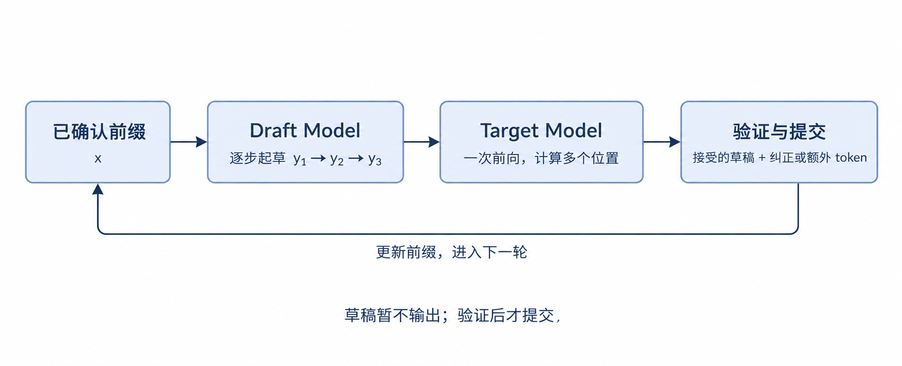
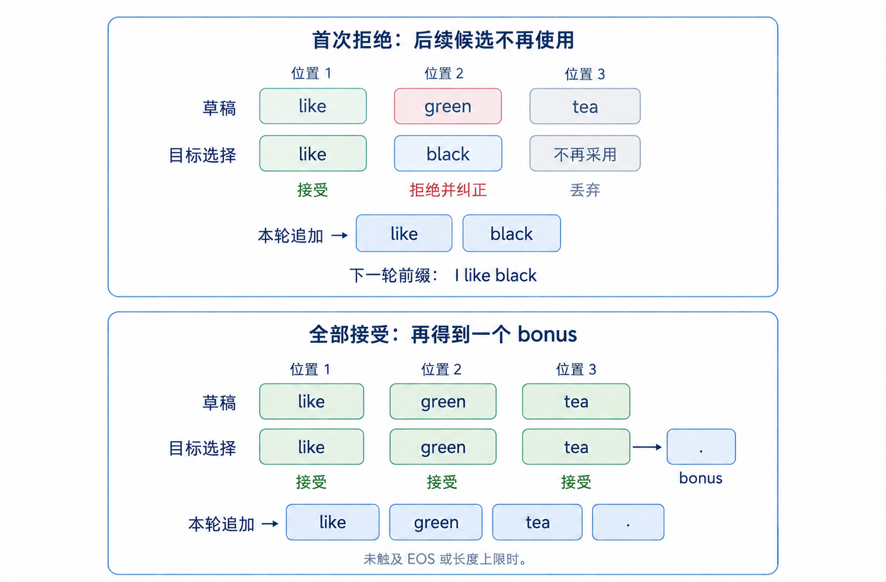
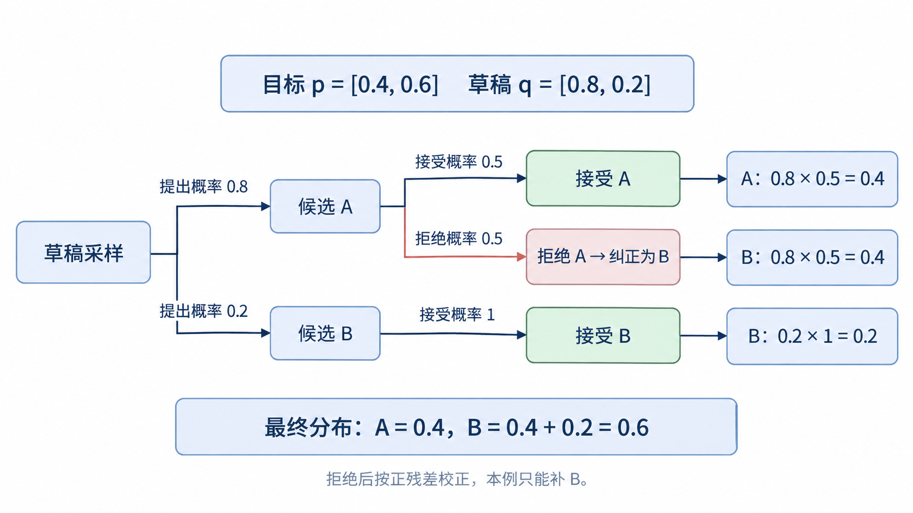

# 第 10 章 投机解码

前面几章中，我们通过 KV Cache 避免重复计算历史 token，通过 Continuous Batching 动态地同时处理多个请求，通过张量并行让多张 GPU 共同执行模型。但对单个请求来说，生成过程仍有一个限制：**解码中，通常每调用一次模型，只能确定下一个 token；确定之后，才能继续生成再下一个 token。**

本章介绍投机解码（Speculative Decoding）：先用一个计算成本较低的模型（aka Draft Model）提出若干候选 token，再让原来的模型（aka Target Model）一次验证这些候选。如果连续多个Draft都能被接受，一次验证就能让回答向前推进多个 token。我们先解释为什么这样做可能更快，再用具体例子说明如何验证，以及错误处理。

## 1 本章学习目标

完成本章学习后，你将能够：

1. 解释普通 Decode 的串行依赖问题，以及投机解码解决方案。
2. 用一个例子走完起草、验证、接受、纠正和提交的过程。
3. 区分贪心验证与随机验证，说明二者分别如何保持结果正确。
4. 说明一轮最终输出哪些 token，以及下一轮从哪里继续。
5. 根据每轮耗时与有效输出数量，判断投机解码是否划算。

## 2 为什么还要减少目标模型的调用次数

### 2.1 Decode过程中的先后依赖

假设已经确认的前缀是 $x$，接下来要生成三个 token：$y_1$、$y_2$、$y_3$。普通自回归生成依次计算：

$$
p(y_1\mid x),\qquad
p(y_2\mid x,y_1),\qquad
p(y_3\mid x,y_1,y_2)
$$

在选择 $y_1$ 之前，模型还不知道第二步真正要使用的前缀；在选择 $y_2$ 之前，也不知道第三步的前缀。KV Cache 可以复用已经计算好的历史 K、V，但**每个新位置仍然需要经过模型各层，得到 logits 并选择下一个 token**。

Continuous Batching 能让多个请求的这一步一起执行，TP 能把这一步的计算分到多张卡上，但二者都不会直接取消同一个请求中相邻 token 的依赖。要继续降低单个请求的生成延迟，我们需要减少这种逐步等待。

### 2.2 Speculative Decoding解决法：先猜N个，再同时验证

在低并发 Decode 场景下，每轮参与计算的新 token 较少，GPU 可能花较多时间搬运权重，而没有充分利用计算能力。若能在一次前向中处理更多位置，就有机会把权重读取等成本分摊到多个 token 上。（注意，speculative decoding的收益主要来源于在低并发场景中提高GPU利用率，如果本身并发就很高GPU很满，那么开启speculative decoding不一定能带来性能收益。）

问题是，这些未来 token 还没有生成，如何才能并行N，N+1，N+2...呢？投机解码的做法是先给出一份候选序列，让目标模型有具体的输入可以计算：

- **目标模型（Target Model）**：原本用于生成回答的模型，决定最终输出所遵循的规则，一般比较大，参数量更多。
- **草稿模型（Draft Model）**：以较低成本提出候选，希望尽量接近目标模型的选择，一般比较小。

本章先讨论独立草稿模型和一条线性候选序列。草稿模型通常更小，但参数少本身不是目的；真正需要的是**起草足够便宜，而且连续猜中的部分足够长**。如果起草贵，那就无法得到好的性能提升。如果猜中准确率低，那也会浪费起草的时间，无法得到性能提升。

目标模型仍然要验证这些位置，所以投机解码可能增加总计算量。它争取的是减少昂贵的串行调用，并让一次调用完成更多有效工作。能否缩短实际耗时，取决于节省的时间能否覆盖额外起草与验证的成本。

## 3 一轮投机解码怎样推进多个 token

### 3.1 投机解码基本流程

设当前已经确认的前缀为 $x$，本轮计划起草 $k$ 个 token。草稿模型先基于 $x$ 提出 $y_1$，再基于 $x,y_1$ 提出 $y_2$，直到得到 $y_1,\ldots,y_k$。在这个基础版本中，**草稿模型自身仍然逐步生成，只是每一步的成本较低。**

随后，目标模型对包含这些候选的序列做因果前向，计算各候选之前的预测分布。验证结束后，只把允许接受的部分写入正式输出，并准备下一轮。

| 阶段 | 输入与工作 | 产生的结果 |
| --- | --- | --- |
| 起草 | 草稿模型从已确认前缀出发，逐步提出候选 | 暂存的 $k$ 个草稿 token |
| 验证 | 根据草稿，目标模型并行计算候选对应的预测，按接受规则判断是否接受 | 连续接受的长度，以及纠正 token 或额外 token |
| 提交 | 把通过验证的部分和必要的纠正或额外 token 加入输出 | 下一轮继续使用的已确认前缀 |

  
  
<em>图 1. 起草、验证、提交与下一轮的衔接</em>

### 3.2 为什么目标模型可以一次验证多个位置

回顾 Prefill：prompt 中的 token 已经给定，模型可以在一次前向中计算多个位置，再用因果掩码限制每个位置只能看到自己及之前的输入。验证草稿时也是如此，候选 token 已经给出，因此各位置的计算可以放在同一次前向中。

以三个候选为例，目标模型可以得到：

| 预测分布 | 依赖的前缀 | 用途 |
| --- | --- | --- |
| $p(\cdot\mid x)$ | 已确认前缀 $x$ | 验证 $y_1$ |
| $p(\cdot\mid x,y_1)$ | $x$ 加第一个候选 | 验证 $y_2$ |
| $p(\cdot\mid x,y_1,y_2)$ | $x$ 加前两个候选 | 验证 $y_3$ |
| $p(\cdot\mid x,y_1,y_2,y_3)$ | $x$ 加全部候选 | 全部接受后，再选择一个 token |

这里的并行指多个已给定输入位置的前向计算可以批量执行。**第二行能否用于正式输出，仍取决于 $y_1$ 是否被接受；第三行则要求前两个候选都被接受。** 计算可以提前做，是否采用结果要等验证。

接下来要确定的是：每个候选怎样才算通过验证？这取决于目标模型原本采用的解码规则。下面分别讨论贪心选择与随机采样。

### 3.3 验证方法1：贪心验证（只保留连续一致的部分）

先考虑贪心解码，即每一步选择 logits 最大的 token。此时验证规则很直接：草稿 token 等于目标模型的选择，就接受它；首次不一致时，提交目标模型选择的 token，结束本轮。

下面用单词表示 token，方便阅读，不代表真实 tokenizer 一定按单词切分。假设已确认前缀是 `I`，草稿提出 `like → green → tea`：

| 验证位置 | 草稿候选 | 目标模型在对应前缀下的选择 | 处理 |
| --- | --- | --- | --- |
| `I` 之后 | `like` | `like` | 接受 |
| `I like` 之后 | `green` | `black` | 拒绝 `green`，提交纠正 token `black` |

在第二个位置拒绝 `green` 后，本轮的接受判定立即停止，不再检查旧草稿中的 `tea`，只向输出追加 `like black`。下一轮以 `I like black` 为前缀重新起草，再由目标模型验证新的候选。

  
  
<em>图 2. 贪心验证：首次拒绝与全部接受的两种结果</em>

目标模型在本轮前向中已经计算了第三个位置的预测，但它依赖的是 `I like green`。这个前缀在拒绝后失效，因此相应的预测结果也直接丢弃。**提前算出了预测，不代表拒绝后还会继续判断后续候选是否接受。**

因此，我们关心的是**从第一个候选开始连续接受了多少个**，不能把被拒绝位置之后的匹配计入接受长度。在相同数值计算和并列最大值处理规则下，这种贪心验证每次提交的都是目标模型本来会选择的 token，因此可以与目标模型单独贪心生成保持一致。

### 3.4 验证方法2：随机采样验证（保持目标分布）

贪心解码每步选择概率最高的 token，而随机采样会按概率抽取，不同 token 都有机会被选中。相应地，随机验证要保持的是**目标模型的输出分布**，不要求每次都选中概率最高的 token，也不保证同一个 seed 下与普通采样逐 token 相同。

设同一前缀下，目标模型的采样分布为 $p$，草稿模型的采样分布为 $q$，两者使用相同含义的 token ID。从 $q$ 中抽出候选 $y$ 后，以如下概率接受：

$$
\alpha(y)=\min\left(1,\frac{p(y)}{q(y)}\right)
$$

如果草稿提出 $y$ 的概率不超过目标所需的概率，就全部接受；如果草稿过于偏爱它，就拒绝其中一部分。首次拒绝后，从归一化的正残差中抽取纠正 token：

$$
r(v)=\frac{\max(p(v)-q(v),0)}{\sum_u\max(p(u)-q(u),0)}
$$

这一步把概率补给草稿分布中概率低于目标分布的 token。例如，目标对 A、B 的概率为 $p=[0.4,0.6]$，草稿为 $q=[0.8,0.2]$：

| 候选 | 提出概率 | 接受概率 | 直接接受的概率贡献 |
| --- | --- | --- | --- |
| A | $0.8$ | $0.5$ | $0.4$ |
| B | $0.2$ | $1$ | $0.2$ |

剩余 $0.4$ 的概率进入拒绝分支。正残差为 $[0,0.4]$，所以拒绝后只能补出 B，最终得到 $[0.4,0.6]$，正好回到目标分布。若拒绝后直接从 $p$ 重抽，就会再次增加 A 的概率，破坏这一结果。

  
  
<em>图 3. 随机验证：接受与拒绝校正共同恢复目标分布</em>

**温度、Top-k 和 Top-p 放在哪里？** 它们用于调整采样分布：温度控制分布的平缓程度，Top-k 保留概率最高的 $k$ 个候选，Top-p 保留累计概率达到阈值的最小高概率候选集合。这里 Top-k 的 $k$ 与本轮草稿长度无关。应用这些规则后，使用各自实际采样、已归一化的 $p$、$q$ 进行上述验证；它们不需要各自对应一套新的接受流程。

**选择哪种验证方法，取决于目标模型原本采用的生成策略。** 投机解码要加速这套策略，同时保持其输出规则：

| 比较项 | 贪心验证 | 随机采样验证 |
| --- | --- | --- |
| 什么情况下选择 | 目标原本就采用贪心解码，希望每步都取最大概率 token。例如，在固定贪心策略的回归测试中，对比开启投机前后的输出 | 目标原本按概率采样，希望保留输出多样性。例如，创意写作或一次生成多个候选答案时，采用温度、Top-k、Top-p 等采样设置 |
| 为什么 | 目标每步有确定的选择，直接比较候选是否一致即可，无需额外进行概率校正 | 多个 token 都可能是合法输出，只接受最大概率 token 会丢失多样性；需要用接受概率和拒绝校正保持目标分布 |
| 接受候选的依据 | 与目标的最大概率选择相同 | 按 $\min(1,p(y)/q(y))$ 接受 |
| 首次拒绝时如何纠正 | 选择目标的最大概率 token | 从正残差分布采样 |
| 保持的结果 | 相同计算与并列值处理规则下的贪心序列 | 目标的采样分布；不保证相同 seed 下逐 token 相同 |

### 3.5 本轮输出什么，下一轮从哪里继续

两种方法都在首次拒绝处结束本轮，只保留连续接受的草稿和一个纠正 token。后面的候选依赖已经失效的前缀，因此不再使用。

如果全部草稿都被接受，目标模型最后一行已经算出了完整草稿之后的预测，可以再选出一个 **bonus token（额外 token）**：贪心路径取最大概率，随机路径从目标分布抽样。设本轮起草 $k$ 个、连续接受 $a$ 个，在没有触及停止条件时，一轮提交 $a+1$ 个 token，最多为 $k+1$ 个。

停止条件仍以正式输出为准：草稿提出的 EOS 需要验证，被拒绝的 EOS 不会直接结束请求；正式输出 EOS 或达到长度上限时停止，即使还有候选或 bonus，也不能继续追加。

下一轮从实际提交的前缀继续，缓存也必须对应这一前缀。沿用前面的例子，输出变为 `I like black` 后，可以保留 `I like` 的有效 KV，但不能继续使用 `green tea` 的 KV；新选出的 `black` 还需要计算自己的 KV。具体怎样回收缓存、更新两侧状态，留到代码走读中展开。

## 4 什么时候投机解码能加速

### 4.1 比较每个有效输出 token 的成本

前面解释了为什么可以减少目标模型的调用次数，但一次投机包含起草、验证和状态更新。把这些成本合在一起，才能判断是否划算：

$$
T_{\mathrm{token,spec}}
\approx
\frac{T_{\mathrm{round}}}{\mathbb{E}[m]}
$$

其中，$T_{\mathrm{round}}$ 是一整轮投机的耗时，$\mathbb{E}[m]$ 是每轮平均正式提交的 token 数，包含纠正或 bonus token。忽略起止阶段后，只有这个平均成本小于普通 Decode 生成一个 token 的耗时，才有机会加速。

例如，普通 Decode 每步耗时 10ms，投机一轮共耗时 16ms，平均提交 3.2 个 token，则平均每个 token 花 $16/3.2=5$ms，对应约 2 倍的 Decode 加速。如果平均只能提交 1.2 个 token，每个 token 约花 13.3ms，反而更慢。这些是假设数字，只用于说明计算方法。

### 4.2 草稿长度、模型与负载如何影响收益

**草稿长度决定一轮最多能推进多远。** 增加长度也会增加起草和验证成本，而且后面的候选只有在前面全部接受时才能使用。如果经常在第二个位置就拒绝，继续起草到第八个位置的价值就很有限。

**草稿模型决定起草成本与接受表现。** 更强的草稿可能连续猜中更多 token，但自身也可能更慢、占用更多显存。选择时需要比较整轮成本与有效输出数量，而不能只看接受率。

**实际负载决定还有多少加速空间。** 第 2 节讨论过低并发下利用空闲计算能力的机会；此外，长上下文会增加 Attention 读取历史 KV 的成本，草稿权重和额外缓存也会影响可支持的并发量。因此，单请求的 Decode 加速比不能直接当作服务吞吐的提升比例。

评估时应固定目标模型、硬件、输入数据、采样参数及输出长度限制，同时观察每轮提交数、整轮耗时、Decode 延迟与服务吞吐。若请求的大部分时间花在 Prefill 上，即使 Decode 明显变快，端到端收益仍可能有限。

理解这些概念后，可以继续阅读[第十章代码走读](https://github.com/Hayden727/zero-to-sglang/blob/e0a27e53cd602325b8bee66598929f63a04499aa/course-material/ch/part2/第10章_投机解码_代码.md)，进一步看验证位置如何对齐、候选如何传给目标模型，以及接受结果如何影响缓存。本章聚焦独立草稿与线性候选，候选树和其他草稿机制不在此展开。

## 5 总结与测试题

### 5.1 课程总结

投机解码把生成分成低成本起草与目标模型验证，让一次目标调用有机会确认多个 token。贪心验证保持目标的贪心选择，随机采样验证通过接受概率和拒绝校正保持目标分布；连续接受的草稿越长，一次验证带来的有效进展就越多。

这种方法用额外工作换取更少的串行等待，是否加速要看整轮耗时能否被有效输出数量摊薄。它与前面的缓存、调度和多卡并行一起，构成了 Part II 从基本生成走向高效推理的完整路径。

### 5.2 测试题

1. KV Cache、Continuous Batching 和 TP 为什么没有直接消除单个请求中相邻 token 的依赖？投机解码怎样为并行验证提供输入？
2. 草稿提出 `like green tea`，目标接受 `like`、把 `green` 纠正为 `black`。为什么本轮不再检查旧草稿 `tea`，而要从新前缀重新起草和验证？
3. 设目标分布为 $p=[0.3,0.7]$，草稿分布为 $q=[0.6,0.4]$。两个候选各以多大概率被接受？拒绝后使用什么分布？最终输出概率是多少？
4. 温度、Top-k、Top-p 与本章的两种验证方法是什么关系？为什么随机验证保持分布，不等于相同 seed 下输出相同？
5. 全部草稿接受后，bonus token 从哪里来？如果已经达到输出长度上限，还能追加吗？草稿提出的 EOS 被拒绝时，请求是否一定结束？
6. 普通 Decode 每步耗时 8ms，投机一轮共耗时 20ms，平均提交 2 个 token，是否加速？若平均提交数提高到 4，结果怎样变化？为什么这个结果不能直接代表端到端收益？

## 参考资料

- [第 10 章投机解码代码走读：固定版本 e0a27e53](https://github.com/Hayden727/zero-to-sglang/blob/e0a27e53cd602325b8bee66598929f63a04499aa/course-material/ch/part2/第10章_投机解码_代码.md)
- [Leviathan 等：Fast Inference from Transformers via Speculative Decoding](https://arxiv.org/abs/2211.17192)
