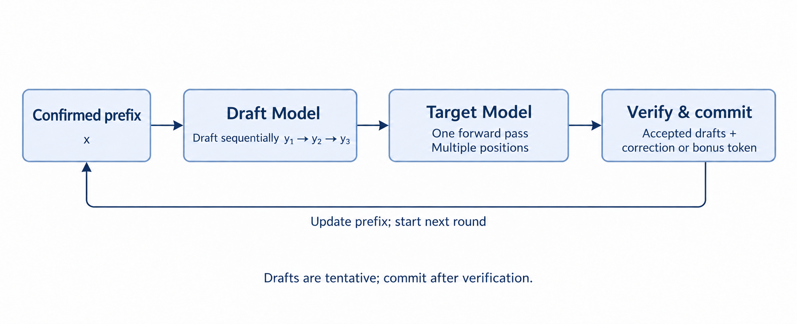
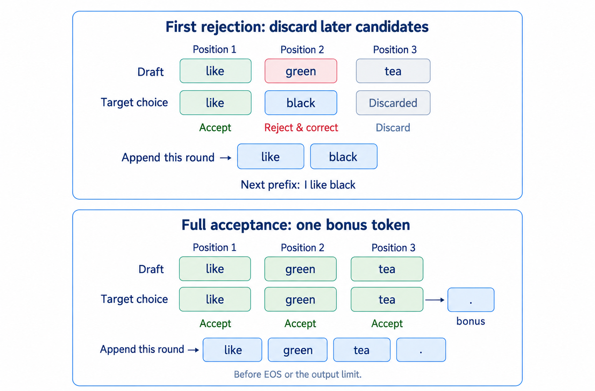
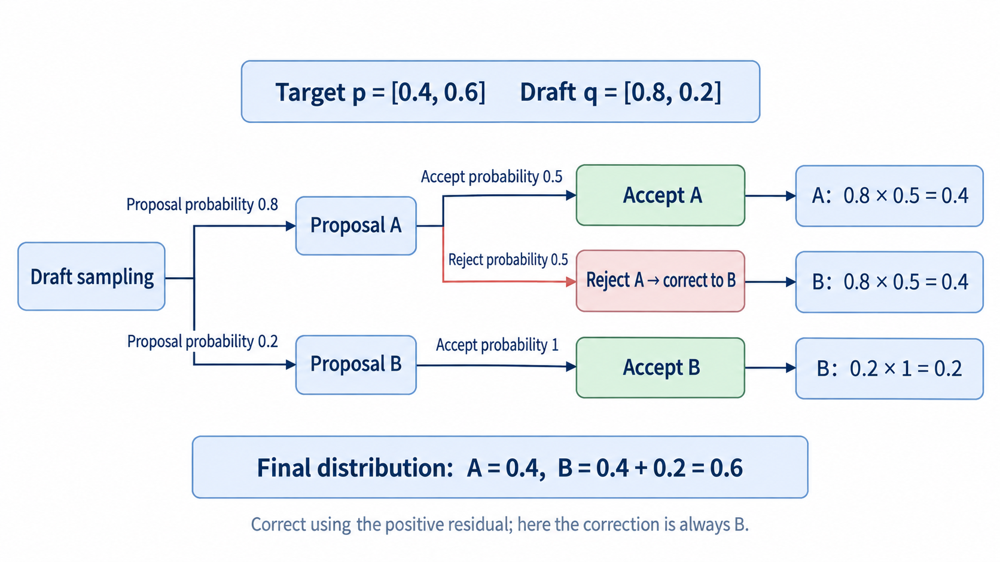

# Chapter 10 Speculative Decoding

In earlier chapters, we used KV caching to avoid recomputing historical tokens, continuous batching to process concurrent requests dynamically, and tensor parallelism to run a model across multiple GPUs. Yet a single request still faces a limitation: **during decoding, each model call usually determines only the next token. That token must be chosen before generation can continue to the following one.**

This chapter introduces speculative decoding: a model with a lower computational cost, the **draft model**, proposes several candidate tokens, and the original **target model** verifies them together. If several consecutive proposals are accepted, one verification round can advance the response by multiple tokens. We first explain why this can be faster, then use concrete examples to show how verification and corrections work.

## 1 Learning Objectives

After completing this chapter, you will be able to:

1. Explain the sequential dependency in ordinary decoding and how speculative decoding addresses it.
2. Walk through drafting, verification, acceptance, correction, and commitment with an example.
3. Distinguish greedy verification from sampling-based verification and explain how each preserves correctness.
4. Describe what a round outputs and where the next round resumes.
5. Judge whether speculative decoding is worthwhile from the time per round and the number of useful output tokens.

## 2 Why Reduce Target-Model Calls Further?

### 2.1 Sequential Dependencies During Decoding

Suppose the confirmed prefix is $x$, and the next three tokens to generate are $y_1$, $y_2$, and $y_3$. Ordinary autoregressive generation computes:

$$
p(y_1\mid x),\qquad
p(y_2\mid x,y_1),\qquad
p(y_3\mid x,y_1,y_2)
$$

Before choosing $y_1$, the model does not know the actual prefix for the second step. Before choosing $y_2$, it does not know the prefix for the third. KV caching reuses previously computed keys and values, but **each new position must still pass through the model's layers to obtain logits and select the next token**.

Continuous batching executes this step for several requests together, while TP distributes its computation across GPUs. Neither directly removes the dependency between adjacent tokens within one request. Further reducing generation latency requires reducing this sequential waiting.

### 2.2 The Speculative Decoding Approach: Guess Several Tokens, Then Verify Together

At low concurrency, each decoding round processes relatively few new tokens. The GPU may spend much of its time moving weights without fully using its compute capacity. Processing more positions in one forward pass can spread costs such as weight reads across multiple tokens. Much of this opportunity comes from improving GPU utilization at low concurrency; if high concurrency already keeps the GPU busy, speculative decoding may not improve performance.

But future tokens have not been generated yet. How can positions $N$, $N+1$, and $N+2$ be processed together? Speculative decoding first supplies a candidate sequence, giving the target model concrete inputs to evaluate:

- **Target model**: the original model used to generate the response. It determines the rules that the final output must follow and usually has more parameters.
- **Draft model**: a usually smaller model that proposes candidates at a lower cost, aiming to approximate the target's choices.

This chapter starts with an independent draft model and a single linear candidate sequence. A smaller model is useful only if **drafting is cheap enough and enough consecutive proposals are accepted**. Expensive drafting can consume the potential savings; poor acceptance can waste the time spent drafting.

The target still has to verify the proposed positions, so speculative decoding can increase total computation. Its aim is to reduce expensive sequential calls and do more useful work per call. Actual latency improves only when the time saved covers the extra drafting and verification costs.

## 3 How One Round Advances Multiple Tokens

### 3.1 The Basic Speculative Decoding Process

Let the confirmed prefix be $x$, and suppose this round will draft $k$ tokens. The draft model proposes $y_1$ from $x$, then $y_2$ from $x,y_1$, continuing until it has $y_1,\ldots,y_k$. In this basic version, **the draft model still generates sequentially; each step is simply cheaper.**

The target then performs a causal forward pass over inputs containing these candidates, computing the predictive distribution before each proposal. After verification, only the permitted output is committed, and the next round is prepared.

| Stage | Input and work | Result |
| --- | --- | --- |
| Draft | Generate candidates sequentially from the confirmed prefix | $k$ temporary draft tokens |
| Verify | Compute target predictions for the proposed positions in parallel, then apply the acceptance rule | The accepted prefix length and a correction or bonus token |
| Commit | Append the accepted part and any required correction or bonus token to the output | The confirmed prefix for the next round |

  
  
<em>Figure 1. Connecting drafting, verification, commitment, and the next round</em>

### 3.2 Why the Target Can Verify Multiple Positions at Once

Recall prefill: the prompt tokens are already given, so the model can compute multiple positions in one forward pass. A causal mask limits each position to its own input and earlier inputs. Verification works similarly: the draft tokens are already available, allowing their positions to be processed in the same forward pass.

For three proposals, the target can obtain:

| Predictive distribution | Conditioning prefix | Purpose |
| --- | --- | --- |
| $p(\cdot\mid x)$ | Confirmed prefix $x$ | Verify $y_1$ |
| $p(\cdot\mid x,y_1)$ | $x$ plus the first proposal | Verify $y_2$ |
| $p(\cdot\mid x,y_1,y_2)$ | $x$ plus the first two proposals | Verify $y_3$ |
| $p(\cdot\mid x,y_1,y_2,y_3)$ | $x$ plus all proposals | Select one more token if all are accepted |

Here, parallel computation means that the forward computation for multiple known input positions can run together. **The second row can contribute to committed output only if $y_1$ is accepted; the third requires both earlier proposals to be accepted.** Computation happens in advance, but verification determines whether its results can be used.

What makes a proposal pass verification? That depends on the target's original decoding rule. We next consider greedy selection and random sampling.

### 3.3 Method 1: Greedy Verification—Keep Only the Consecutive Matches

Greedy decoding selects the token with the largest logit at each step. Verification is straightforward: accept a proposal if it matches the target's choice. At the first mismatch, commit the target's chosen token and end the round.

For readability, the example below uses words as tokens; a real tokenizer does not necessarily split text this way. Suppose the confirmed prefix is `I`, and the draft proposes `like → green → tea`:

| Verification position | Proposal | Target choice under the corresponding prefix | Action |
| --- | --- | --- | --- |
| After `I` | `like` | `like` | Accept |
| After `I like` | `green` | `black` | Reject `green` and commit the correction `black` |

Once `green` is rejected at the second position, acceptance checking stops immediately. The old proposal `tea` is not checked, and the round appends only `like black`. The next round drafts fresh candidates from `I like black`, which the target then verifies.

  
  
<em>Figure 2. Greedy verification: first rejection versus full acceptance</em>

The target has already computed the third prediction in this round's forward pass, but that prediction depends on `I like green`. Rejection invalidates this prefix, so the corresponding prediction is discarded. **Computing predictions in advance does not mean acceptance checking continues past the first rejection.**

What matters is **how many proposals are accepted consecutively from the beginning**; matches after a rejected position cannot count toward the accepted length. With the same numerical computation and tie-breaking rules, greedy verification always commits the token the target would have selected, preserving the sequence produced by target-only greedy decoding.

### 3.4 Method 2: Sampling-Based Verification—Preserve the Target Distribution

Greedy decoding selects the most probable token at every step. Random sampling instead draws according to probabilities, giving different tokens a chance of being selected. Sampling-based verification therefore preserves **the target model's output distribution**. It does not require the highest-probability token at every step or guarantee the same token sequence as ordinary sampling under the same seed.

Let $p$ be the target sampling distribution and $q$ the draft sampling distribution under the same prefix, with the same meanings assigned to token IDs. After drawing a proposal $y$ from $q$, accept it with probability:

$$
\alpha(y)=\min\left(1,\frac{p(y)}{q(y)}\right)
$$

If the draft proposes $y$ no more often than the target requires, always accept it. If the draft favors it too much, reject some of those proposals. At the first rejection, sample a correction from the normalized positive residual:

$$
r(v)=\frac{\max(p(v)-q(v),0)}{\sum_u\max(p(u)-q(u),0)}
$$

This gives the missing probability mass to tokens that the draft underproposes. For example, suppose the target probabilities for A and B are $p=[0.4,0.6]$, while the draft uses $q=[0.8,0.2]$:

| Candidate | Proposal probability | Acceptance probability | Probability contributed by direct acceptance |
| --- | --- | --- | --- |
| A | $0.8$ | $0.5$ | $0.4$ |
| B | $0.2$ | $1$ | $0.2$ |

The remaining probability mass of $0.4$ enters the rejection branch. The positive residual is $[0,0.4]$, so the correction must be B. The final distribution is $[0.4,0.6]$, exactly the target distribution. Resampling directly from $p$ after rejection would increase A's probability again and break this result.

  
  
<em>Figure 3. Acceptance and rejection correction together restore the target distribution</em>

**Where do temperature, Top-k, and Top-p fit?** They adjust the sampling distribution: temperature controls how flat it is, Top-k retains the $k$ most probable candidates, and Top-p retains the smallest set of highest-probability candidates whose cumulative probability reaches the threshold. The $k$ in Top-k is unrelated to the number of draft tokens in a round. Apply verification to the normalized $p$ and $q$ actually used for sampling after these adjustments; each setting does not need a separate acceptance procedure.

**The verification method follows the target model's original generation strategy.** Speculative decoding accelerates that strategy while preserving its output rules:

| Comparison | Greedy verification | Sampling-based verification |
| --- | --- | --- |
| When to choose it | The target already uses greedy decoding and should select the most probable token at each step. For example, a regression test may compare outputs with and without speculation under a fixed greedy policy | The target already samples by probability and should retain output diversity. For example, creative writing or generating multiple candidate answers may use temperature, Top-k, or Top-p settings |
| Why | The target has a definite choice at each step, so comparing tokens is sufficient; no additional probability correction is needed | Multiple tokens are valid outputs. Accepting only the most probable one would lose diversity, so acceptance probabilities and rejection correction must preserve the target distribution |
| Acceptance rule | Match the target's highest-probability choice | Accept with probability $\min(1,p(y)/q(y))$ |
| Correction at the first rejection | Select the target's highest-probability token | Sample from the positive residual distribution |
| Result preserved | The greedy sequence under the same computation and tie-breaking rules | The target sampling distribution, without guaranteeing token-by-token equality under the same seed |

### 3.5 What This Round Outputs and Where the Next Begins

Both methods end the round at the first rejection, keeping only the consecutively accepted proposals and one correction token. Later candidates depend on a prefix that is no longer valid and are discarded.

If all proposals are accepted, the target's final row has already predicted what follows the complete draft. It can supply one **bonus token**: greedy decoding takes the most probable token, while sampling draws from the target distribution. With $k$ proposals and $a$ consecutive acceptances, a round commits $a+1$ tokens, up to $k+1$, provided no stopping condition is reached.

Stopping conditions still follow committed output. A proposed EOS must be verified; a rejected EOS does not itself end the request. Stop when EOS is committed or the output length limit is reached, even if more candidates or a bonus remain available.

The next round starts from the prefix actually committed, and the cache must match that prefix. In the earlier example, once the output becomes `I like black`, the valid KV for `I like` can be retained, but the KV for `green tea` cannot be reused as history. The newly selected `black` still needs its own KV computation. Cache reclamation and state updates on both sides are covered in the code walkthrough.

## 4 When Does Speculative Decoding Improve Performance?

### 4.1 Compare the Cost per Useful Output Token

We have seen how target-model calls can be reduced, but a speculative round includes drafting, verification, and state updates. All of these costs must be included when deciding whether it pays off:

$$
T_{\mathrm{token,spec}}
\approx
\frac{T_{\mathrm{round}}}{\mathbb{E}[m]}
$$

Here, $T_{\mathrm{round}}$ is the time for a complete speculative round, and $\mathbb{E}[m]$ is the average number of committed tokens per round, including corrections or bonuses. Ignoring startup and ending effects, acceleration requires this average cost to be lower than the time to generate one token with ordinary decoding.

For example, suppose ordinary decoding takes 10ms per step, while a speculative round takes 16ms and commits 3.2 tokens on average. Each output token then costs $16/3.2=5$ms on average, giving about a 2× decoding speedup. If the average falls to 1.2 committed tokens, the cost becomes about 13.3ms per token, which is slower. These are hypothetical numbers used only to illustrate the calculation.

### 4.2 How Draft Length, Model Choice, and Workload Affect the Benefit

**Draft length sets the maximum progress per round.** A longer draft also costs more to generate and verify, and later proposals are useful only if all earlier ones are accepted. If rejection frequently occurs at the second position, drafting through the eighth has little value.

**The draft model determines drafting cost and acceptance behavior.** A stronger draft may get more consecutive proposals accepted, but it can also be slower and use more memory. Compare the total cost per round with useful output rather than considering acceptance rate alone.

**The workload determines how much room remains for acceleration.** Section 2 discussed using spare compute capacity at low concurrency. Long contexts also increase the cost of reading historical KV during attention, while draft weights and extra caching affect the concurrency that fits in memory. A single-request decoding speedup therefore cannot be treated as an equivalent improvement in service throughput.

For evaluation, hold the target model, hardware, input data, sampling settings, and output length limit fixed. Measure committed tokens per round, total round time, decoding latency, and service throughput. If prefill accounts for most of a request's time, even a substantial decoding speedup may have a limited effect on end-to-end latency.

With these concepts in place, continue to the [Chapter 10 code walkthrough](https://github.com/Hayden727/zero-to-sglang/blob/e0a27e53cd602325b8bee66598929f63a04499aa/course-material/eng/part2/Chapter10_Speculative-Decoding_code.md) for verification-row alignment, how candidates reach the target, and how acceptance affects caching. This chapter focuses on independent drafting and linear candidates; candidate trees and other draft mechanisms are outside its scope.

## 5 Summary and Exercises

### 5.1 Summary

Speculative decoding separates low-cost drafting from target-model verification, allowing one target call to confirm multiple tokens. Greedy verification preserves the target's greedy choices. Sampling-based verification uses acceptance probabilities and rejection correction to preserve the target distribution. Longer consecutive accepted prefixes let each verification round make more useful progress.

The method trades extra work for less sequential waiting. Whether it is faster depends on how much useful output shares the cost of each round. Together with caching, scheduling, and multi-GPU execution, it completes Part II's path from basic generation to efficient inference.

### 5.2 Exercises

1. Why do KV caching, continuous batching, and TP not directly remove the dependency between adjacent tokens in a single request? How does speculative decoding provide inputs for parallel verification?
2. The draft proposes `like green tea`. The target accepts `like` but corrects `green` to `black`. Why does the round stop checking the old proposal `tea` and instead require fresh drafting and verification from the new prefix?
3. Let $p=[0.3,0.7]$ and $q=[0.6,0.4]$. What is each candidate's acceptance probability? Which distribution is used after rejection, and what is the final output distribution?
4. How do temperature, Top-k, and Top-p relate to the two verification methods? Why does preserving a sampling distribution not imply identical output under the same seed?
5. Where does the bonus token come from after full acceptance? Can it be appended after the output length limit is reached? Does rejection of a proposed EOS necessarily end the request?
6. Ordinary decoding takes 8ms per step. A speculative round takes 20ms and commits two tokens on average. Is it faster? What if it commits four? Why does this result not directly describe the end-to-end benefit?

## References

- [Chapter 10 Speculative Decoding Code Walkthrough: pinned revision e0a27e53](https://github.com/Hayden727/zero-to-sglang/blob/e0a27e53cd602325b8bee66598929f63a04499aa/course-material/eng/part2/Chapter10_Speculative-Decoding_code.md)
- [Leviathan et al.: Fast Inference from Transformers via Speculative Decoding](https://arxiv.org/abs/2211.17192)
